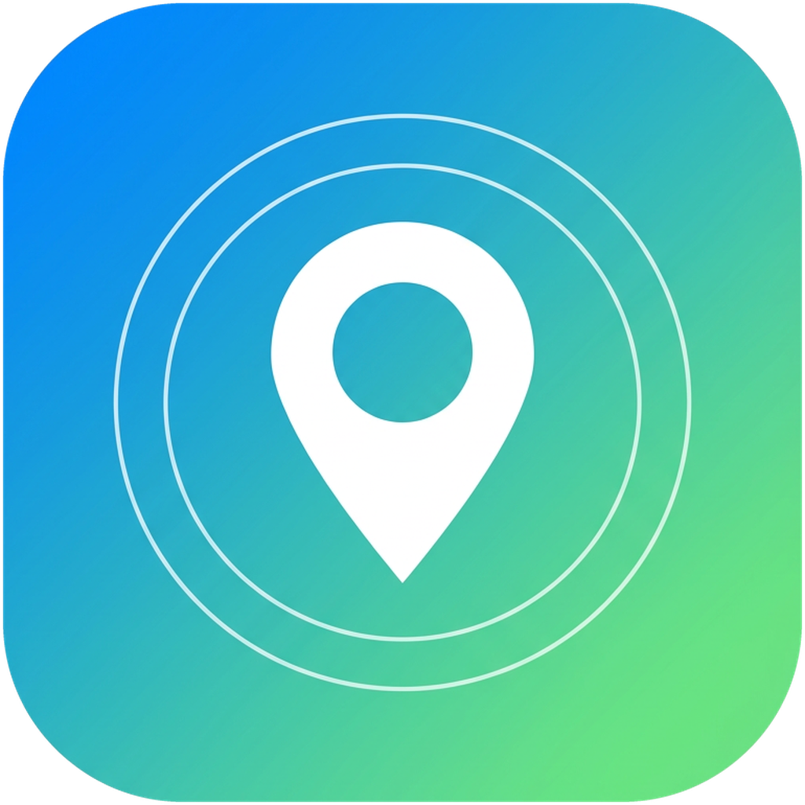
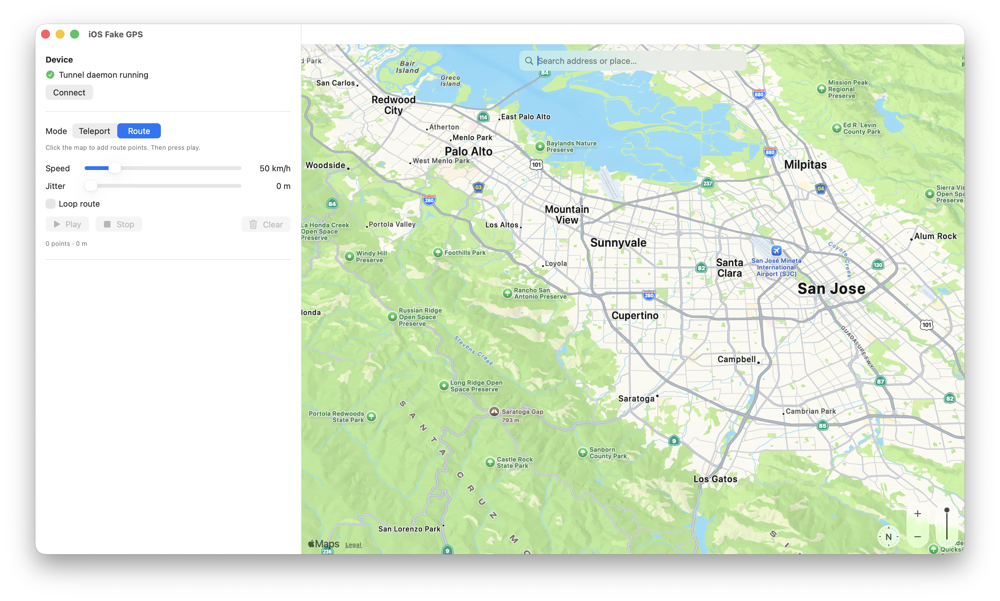

  

<h1 align="center">iOS Fake GPS</h1>

一款 Lockito 风格的 iPhone 定位模拟器 —— 纯净的 macOS 原生应用。

  
  
  
  
  

  <a href="https://github.com/gly/fake-gps/releases/latest"><b>⬇️ 下载 macOS 版</b></a>
  &nbsp;·&nbsp;
  <a href="https://github.com/gly/fake-gps/discussions">讨论区</a>
  &nbsp;·&nbsp;
  ⭐ 如果这个项目对你有帮助，欢迎点个 Star！

在**未越狱**的 iPhone 上设置固定位置，**或**播放移动路线（可调节速度、循环
和 GPS 抖动）。一切都通过原生 macOS 应用驱动 —— 只需用数据线把 iPhone 连上 Mac。

这是 Android 上 **Lockito** 的 iOS 对应版本。与 Android 不同，iOS 没有公开的
"模拟定位" API，所以安装在*手机上*的应用无法为其他应用伪造 GPS。本项目改用
Apple 的**开发者隧道**（developer tunnel）从连接的 Mac 端驱动定位 —— 与 Xcode
调试时模拟位置用的是同一机制。你设置的任何位置都会被设备上**所有应用**视为
系统级定位。

> **请负责任地使用。** 本工具用于测试你自己的位置感知应用以及个人用途。
> 用它规避反作弊、实施欺诈或绕过基于位置的访问控制，违反相关服务条款，
> 也可能触犯法律。
